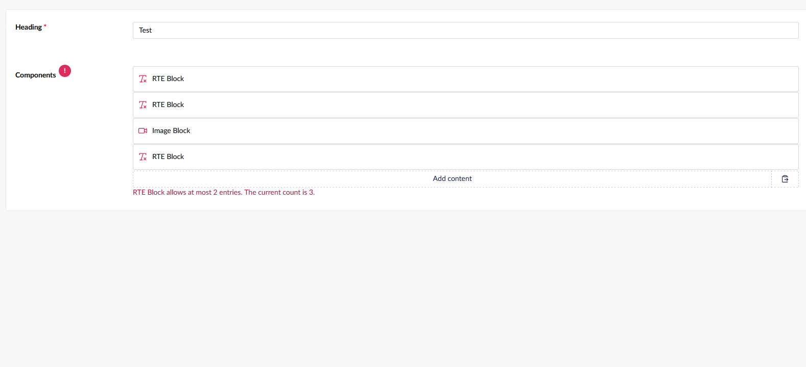
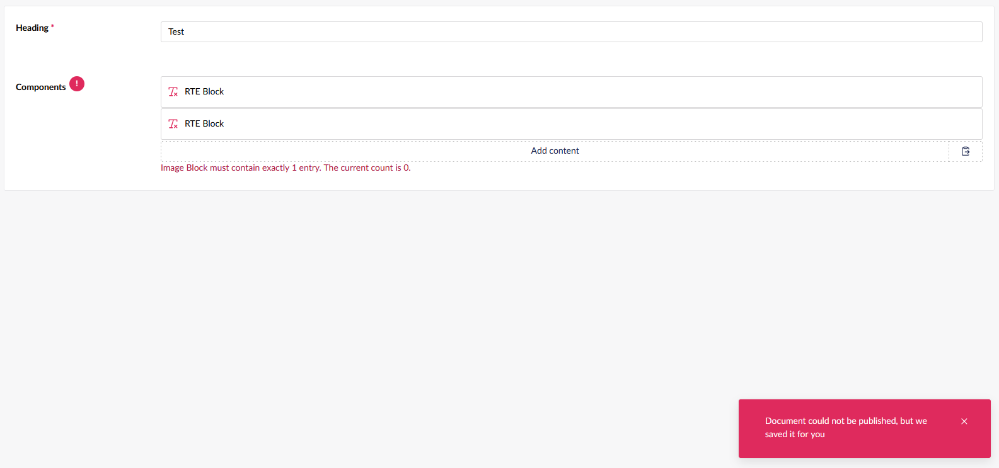
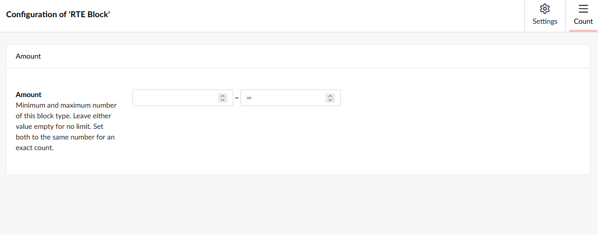

# BlockCount

Per-block-type minimum and maximum counts for Umbraco Block List and Block Grid.

BlockCount adds a Count tab to each allowed block type. The limits are stored on the data type. The backoffice shows a validation message while the counts are wrong, and the server cancels publish when a document still breaks them.


## Install

Add a project reference:

```xml
<ProjectReference Include="..\BlockCount\BlockCount.csproj" />
```

Or pack and reference the NuGet package:

```bash
dotnet pack src/BlockCount/BlockCount.csproj -c Release
```

```xml
<PackageReference Include="BlockCount" Version="1.17.0" />
```

The package is a Razor Class Library. Umbraco discovers `App_Plugins/BlockCount/umbraco-package.json` from the referenced project or package. No composer registration is required in the website.

## Configuration

1. Open a Block List or Block Grid data type.
2. Open an allowed block type.
3. Open the **Count** tab.
4. Set **Amount**.

Leave either number empty for no limit on that side. Set both numbers to the same value for an exact count. `0` is a valid minimum. Negative numbers are rejected. A minimum greater than the maximum is invalid configuration and fails publish.

The existing Amount field on the data type still limits the total number of blocks. BlockCount limits each block type on its own.

Example:

| Block type | Minimum | Maximum |
| --- | --- | --- |
| Image | 1 | 1 |
| Rich text | 0 | 3 |
| Video | 1 | 2 |

## Screenshots







